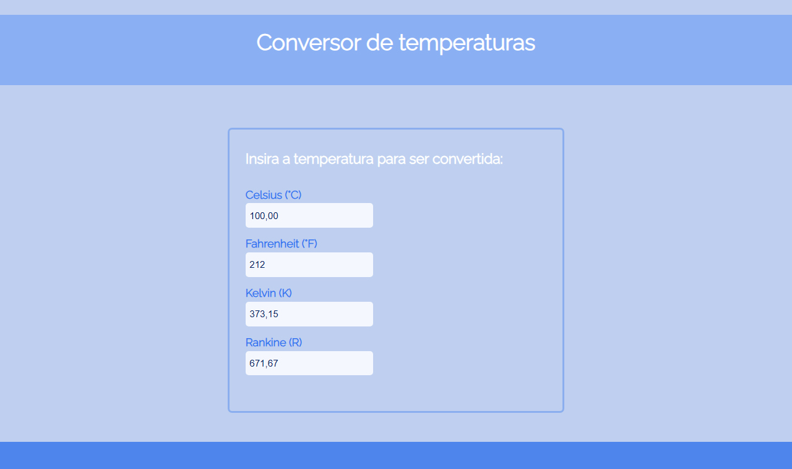
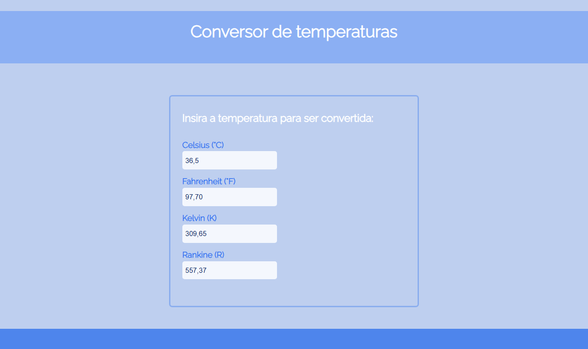
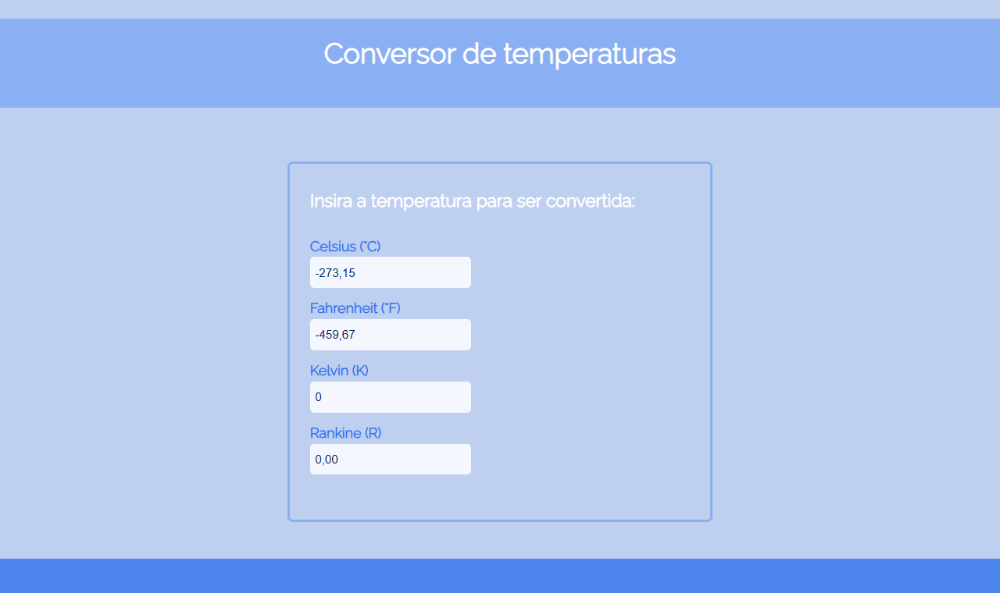

# Conversor de Temperaturas

[](LICENSE)

Conversor de temperaturas feito com HTML, CSS e JavaScript puro. Ao digitar um valor em qualquer escala, as outras três são convertidas automaticamente.

**Acesse o app:** https://plovatto.github.io/Conversor/

> **Projeto de estudo (2022):** meu primeiro projeto publicado no GitHub, mantido aqui para mostrar o início da minha evolução como desenvolvedora.

<p align="center">
  
</p>

<p align="center"><em>Ao digitar em qualquer escala, as outras são preenchidas na hora</em></p>

<table>
  <tr>
    <td width="50%"></td>
    <td width="50%"></td>
  </tr>
  <tr>
    <td align="center"><em>Temperatura do corpo humano</em></td>
    <td align="center"><em>Zero absoluto a partir de Kelvin</em></td>
  </tr>
</table>

## Funcionalidades

- Conversão entre Celsius, Fahrenheit, Kelvin e Rankine
- Conversão a partir de qualquer uma das quatro escalas
- Atualização automática enquanto o valor é digitado, com debounce de 500 ms
- Resultados com duas casas decimais
- Limpeza dos outros campos quando o valor é apagado

## Tecnologias

- HTML5
- CSS3
- JavaScript (eventos de input, arrow functions e debounce)
- [Google Fonts](https://fonts.google.com/) - fonte Raleway
- GitHub Pages - hospedagem

## Como Executar

O projeto não tem dependências nem etapa de build.

Clone o repositório:

```bash
git clone https://github.com/Plovatto/Conversor.git
```

Acesse a pasta do projeto e abra o arquivo `index.html` no navegador:

```bash
cd Conversor
```

## Deploy

O site é publicado no GitHub Pages diretamente a partir da branch `main`, sem etapa de build.

## Estrutura do Projeto

```text
├── css/
│   └── style.css     # Estilos do conversor
├── js/
│   └── script.js     # Fórmulas de conversão e eventos dos campos
├── docs/             # Imagens usadas neste README
└── index.html
```

## Licença

Distribuído sob a [Licença MIT](LICENSE).
